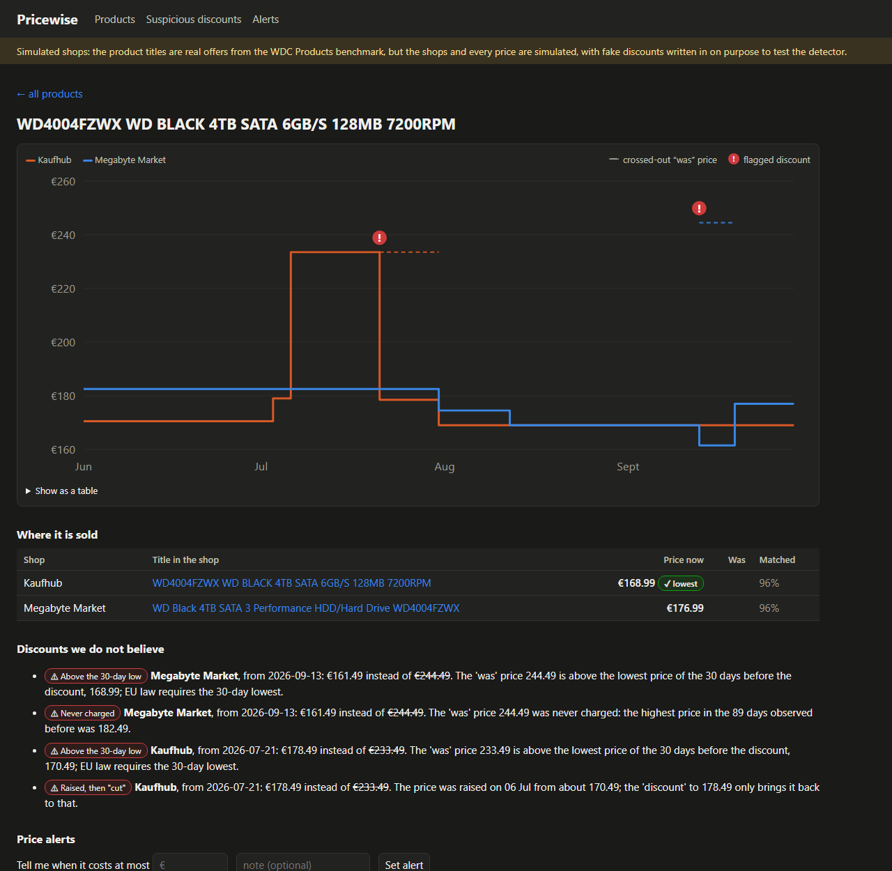
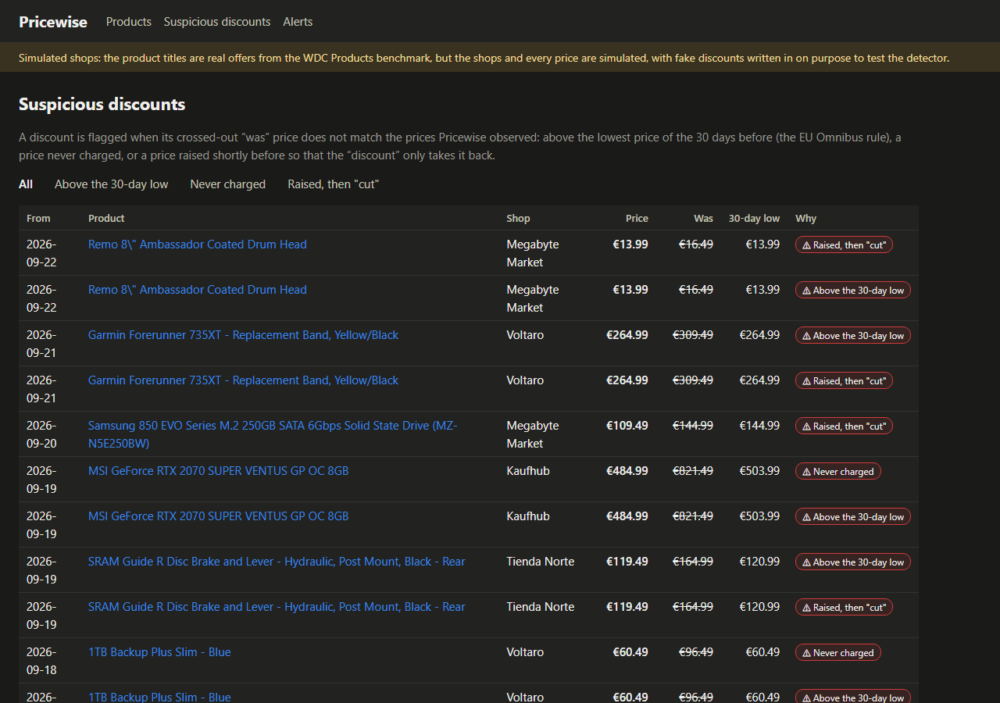

# Pricewise

Pricewise tracks what the same product costs in different shops. It does four things:

- recognises one product across shops, even when each shop titles it differently;
- keeps every product's price history;
- flags "discounts" whose crossed-out *was* price is not true;
- tells you when a product drops below a price you set.



The parts, each in the language that suits it:

| Part | Language | What it does |
|---|---|---|
| `collector/` | Go | Collects prices with hundreds of concurrent requests and a per-shop token bucket. Obeys robots.txt, crawls only the shops on an allowlist, and reads prices from schema.org JSON-LD. Also holds the shop simulator. |
| `matcher/` | Rust | Matches offers to products: HNSW nearest-neighbour search over ONNX title embeddings, normalisation rules (capacity, colour, model code, brand) as vetoes, and a local LLM for borderline pairs. |
| `ml/` | Python | Fine-tunes the embedder and trains the match scorer. Holds the fake-discount detector and all the evaluations. |
| `dashboard/` | TypeScript, Next.js | Price history per shop, suspicious-discount badges, price alerts. |
| `db/` | SQL | PostgreSQL 17 with TimescaleDB: a hypertable for prices and a continuous aggregate for daily prices. |

## Scraping responsibly, and what is simulated

**The prices in this repository's demo and evaluations are simulated. The product titles are real.**

| What | Real or simulated | Where it comes from |
|---|---|---|
| Product titles | Real | 1,000 offers for 500 products from the test set of the [WDC Products](https://webdatacommons.org/largescaleproductcorpus/wdc-products/) benchmark, as real shops wrote them |
| Shops | Simulated | Five shops on localhost, served by `shopsim` |
| Prices and discounts | Simulated | 120 days of prices per offer, with genuine and fake discounts written in on purpose |

The fake discounts are there so the detector can be measured against a known truth. No real shop was crawled to build this.

The collector can run against real shops, but only under rules it enforces itself:

- **Allowlist only.** It crawls only sites listed in an allowlist file (`collector/sites.example.json`).
- **Terms checked first.** It refuses a real site unless the entry records who read the site's terms of use, and when (`terms_checked`). Add a shop only if its terms allow automated price collection.
- **robots.txt, strictly.** It follows RFC 9309:
  - the most specific user-agent group applies;
  - the longest matching rule wins;
  - `*` and `$` wildcards are supported;
  - `Crawl-delay` caps the request rate;
  - an unreachable robots.txt or a 5xx/429 answer means *crawl nothing*.

  This holds even for an allowlisted site. The simulated "Closed Market" is on the allowlist and shuts PricewiseBot out in its robots.txt, so the collector requests nothing from it but robots.txt.
- **Rate limits.** Each host gets its own token bucket. After a 429, the bucket halves its rate and the collector honours `Retry-After`.
- **No link following.** It takes pages from the site's sitemap only. It identifies itself as `PricewiseBot/0.1 (+repository URL)`.
- **Structured data only.** It reads prices from schema.org JSON-LD, the markup shops publish for machines.

## How matching works

1. **Embedding.** Each offer title becomes a vector. The model is [multilingual-e5-small](https://huggingface.co/intfloat/multilingual-e5-small) (MIT), fine-tuned with a contrastive loss on the 19,835 labelled pairs of WDC Products' training split. That takes about 4 minutes on an RTX 2060. It is exported to ONNX with mean pooling and normalisation inside the graph, and the Rust engine runs it through ONNX Runtime.
2. **Candidates.** An HNSW index, written from scratch in `matcher/src/hnsw.rs`, gives each offer its 10 nearest titles. Pairs from the same shop are skipped.
3. **Rule vetoes.** The rules read identity facts out of each title and veto a pair whose facts contradict each other:
   - capacities and quantities, with units converted (1 TB = 1000 GB, 0,33 l = 330 ml, "2x8GB" = 16 GB);
   - colours, in a dozen languages;
   - model codes of the same family that differ (SN550 vs SN750, C310 vs C920, DDR3 vs DDR4);
   - brands, counted only when each title names its own brand.

   A rule fires only when both titles state the fact. Python (`ml/pricewise_ml/rules.py`) and Rust (`matcher/src/rules.rs`) implement the rules identically, and both are tested on the same cases in `rules/cases.json`.
4. **Scoring.** A logistic regression scores each surviving pair from:
   - the cosine similarity of the two titles;
   - their word overlap;
   - whether they share a code, a quantity or a colour.

   It is trained on the validation split, never on test data.
5. **LLM on borderline pairs.** Pairs in the band where the scorer is least sure go to a local LLM: Qwen2.5-7B-Instruct, Q4_K_M, in llama.cpp. Its answer is held to a JSON schema. Its prompt (`rules/llm_prompt.txt`) was tuned on the validation split.
6. **Grouping.** Products are built greedily from the most confident pairs down. A group never holds two offers from the same shop. When the matcher runs again, products keep their ids, and so do the alerts set on them.

## Results

All numbers below come from the scripts named, and the JSON outputs are in `results/`.

### Matching, on the WDC Products benchmark

The test sets have 80% corner cases: products whose titles look very similar. Each set has 4,500 pairs, 500 of them matches. "Unseen" means the products do not appear in training. Thresholds are chosen on the validation split. Source: `python -m pricewise_ml.evaluate_matching`, output in `results/matching.json`.

F1, with precision / recall in brackets:

| Method | Seen products | 50% unseen | 100% unseen |
|---|---|---|---|
| TF-IDF character n-grams (text only) | 0.302 (0.24 / 0.40) | 0.371 (0.27 / 0.59) | 0.324 (0.23 / 0.58) |
| multilingual-e5-small, not fine-tuned | 0.327 (0.22 / 0.60) | 0.381 (0.26 / 0.74) | 0.393 (0.27 / 0.72) |
| Fine-tuned embedder | 0.678 (0.66 / 0.70) | 0.626 (0.57 / 0.70) | 0.549 (0.48 / 0.64) |
| Fine-tuned embedder + rule vetoes | 0.689 (0.68 / 0.69) | 0.665 (0.64 / 0.69) | 0.594 (0.56 / 0.63) |
| Scorer + rule vetoes | 0.693 (0.64 / 0.75) | 0.651 (0.58 / 0.74) | 0.598 (0.51 / 0.71) |
| **Scorer + rule vetoes + LLM on borderline pairs** | **0.707** (0.68 / 0.74) | **0.714** (0.69 / 0.74) | **0.659** (0.63 / 0.69) |

What this shows:

- **Fine-tuning** roughly doubles F1 over the off-the-shelf model.
- **The rules** add up to 4.5 points. Across the three test sets they wrongly veto only 3, 5 and 4 of the 500 true matches. Most of those look like label noise in the benchmark: one labelled match is "2.54TB" vs "4TB". Meanwhile they veto 790–883 of the 4,000 non-matches.
- **The LLM** helps most on products the embedder never saw: +6 points. It sees 287–398 borderline pairs per test set and is right on 67% to 81% of them.
- **This is a small model.** It is a bi-encoder small enough to embed 90 titles a second on a laptop CPU. Cross-encoders trained on this benchmark score higher, so these numbers are a baseline for a small, fast model, not the state of the art.

**Engine faithfulness** (`python -m pricewise_ml.compare_engines`, `results/engines.json`). On the 9,000 test pairs, the Rust engine (ONNX Runtime, Rust rules and scorer) makes the same veto and match decision as the Python implementation on every pair. Its cosine similarities differ from PyTorch's by at most 1.3 × 10⁻⁶.

**HNSW index**, measured on 5,837 WDC titles with 384 dimensions (recall@10 against exact search):

| `ef` | recall@10 | time per query |
|---|---|---|
| 16 | 99.97% | 0.12 ms |
| 64 | 100% | 0.32 ms |
| exact search | — | 2.7 ms |

### End to end, on the simulated shops

The Go collector replayed 120 simulated days across the five open shops plus the closed one:

| Measure | Result |
|---|---|
| Requests sent | about 124,000 |
| Prices stored | 987–995 a day out of 1,000; the rest were pages the simulator failed with 503 on purpose (1%) |
| `429 Too Many Requests` answers | 1, from the shop whose limit is hidden; the collector then slowed down for good |
| Requests that robots.txt forbids | 0 |
| Requests to the closed shop | 1, for its robots.txt |

**Grouping 1,000 offers into products** (`python -m pricewise_ml.evaluate_grouping`). The truth is 500 products, two offers each. Counted over pairs of offers:

| | Precision | Recall | F1 |
|---|---|---|---|
| Embedder + rules + scorer | 0.434 | 0.646 | 0.519 |
| **+ LLM on borderline pairs** (1,701 of the 5,704 candidate pairs asked) | **0.554** | **0.646** | **0.596** |

This is harder than the pair benchmark: every offer is compared with its nearest neighbours among all 1,000 offers, so near-identical products crowd the candidates. Embedding and indexing take 14 seconds. With the LLM, the whole run takes 20 minutes on an RTX 2060. Two runs with the LLM gave F1 0.592 and 0.596: llama.cpp answers parallel requests in batches, which is not perfectly deterministic even at temperature 0.

**Fake discounts** (`python -m pricewise_ml.evaluate_discounts`, `results/discounts.json`). The detector sees only the prices the collector stored. The truth comes from the simulation. A discount counts as caught if the detector flags it:

| Simulated discounts | Omnibus 30-day rule alone | Full detector |
|---|---|---|
| Raised for 1–3 weeks, then "cut" (95) | 95 | 95 |
| Raised for 5–7 weeks, then "cut": legal on paper (52) | 0 | 43 |
| A "was" price never charged (63) | 63 | 63 |
| **All fakes caught** | 158 / 210 (75%) | **201 / 210 (96%)** |
| Genuine discounts wrongly flagged | 0 / 229 | **0 / 229** |

The rule in the middle column comes from the EU Omnibus Directive (Art. 6a of Directive 98/6/EC): the *was* price must be the lowest price of the 30 days before the reduction. A shop that holds an inflated price for more than 30 days satisfies that rule on paper, so only the inflate-then-drop pattern catches it.

The 9 misses are such long inflations that mostly began in the collector's first three weeks. There was not yet enough history to know the price before the rise.

The simulation is cleaner than real shops, so these figures say the detector does what it is meant to do, not how it would score on a real market.

## Running it

What you need:

- Go 1.27, Rust (stable) and Node 24;
- Python 3.14;
- Docker;
- an NVIDIA GPU, for training and for the LLM.

```bash
scripts/fetch-data.sh --llm          # WDC Products; llama.cpp and Qwen2.5-7B (4.7 GB) for the LLM
docker compose up -d                 # PostgreSQL 17 + TimescaleDB on 127.0.0.1:5433
cd ml
python -m venv .venv && .venv/Scripts/pip install -r requirements.txt --index-url https://download.pytorch.org/whl/cu128 --extra-index-url https://pypi.org/simple
.venv/Scripts/python -m pricewise_ml.embed train      # about 4 minutes
.venv/Scripts/python -m pricewise_ml.embed export
.venv/Scripts/python -m pricewise_ml.evaluate_matching [--llm http://127.0.0.1:8094]   # writes models/scorer.json
cd ..
third_party/llama/llama-server -m third_party/models/Qwen2.5-7B-Instruct-Q4_K_M.gguf --port 8094 -ngl 99 -np 4 &
scripts/demo.sh --llm http://127.0.0.1:8094          # simulate, collect 120 days, match, detect, dashboard on :3020
```

`demo.sh` runs these steps; each can also be run alone:

| Step | Command |
|---|---|
| Serve the simulated shops | `bin/shopsim -catalogue data/sim/catalogue.json` |
| Replay the simulated days | `bin/collector replay -sites collector/sim-sites.json` |
| Collect from real, allowlisted shops | `bin/collector run -sites sites.json -every 6h` |
| Match offers into products | `matcher/target/release/pricewise-match [--llm URL] run` |
| Flag discounts and check alerts | `python -m pricewise_ml.analyse` |
| Start the dashboard | `cd dashboard && npm run dev` |

The other pages of the dashboard:



## Tests

| Part | Tests | What they cover |
|---|---|---|
| Go | 15 | robots.txt parsing and caching; the token bucket; JSON-LD in five markup variants; whole crawls of simulated shops (politeness, recovery from 429, the closed shop) |
| Rust | 7 | the shared rule cases; HNSW recall against exact search; grouping; vetoes |
| Python | 35 | the shared rule cases; the detector's patterns; missing days; too little history |
| TypeScript | 5 | chart geometry |

CI also runs an **integration job** against a real TimescaleDB service container. It loads the schema, serves made-up products from the shop simulator, replays 120 days with the collector, and runs the detector. It then checks that:

- robots.txt was obeyed;
- the closed shop was not crawled;
- the fake discounts were caught.

## Licences

| What | Licence |
|---|---|
| Pricewise's code | MIT |
| [WDC Products](https://webdatacommons.org/largescaleproductcorpus/wdc-products/) (Peeters, Der & Bizer, EDBT 2024) | Built from Common Crawl data, published for research; it states no licence of its own. Not redistributed here: `scripts/fetch-data.sh` downloads it. |
| multilingual-e5-small | MIT |
| Qwen2.5-7B-Instruct | Apache 2.0 |
| llama.cpp | MIT |
| TimescaleDB image | Includes features under the Timescale License; continuous aggregates are among them |
